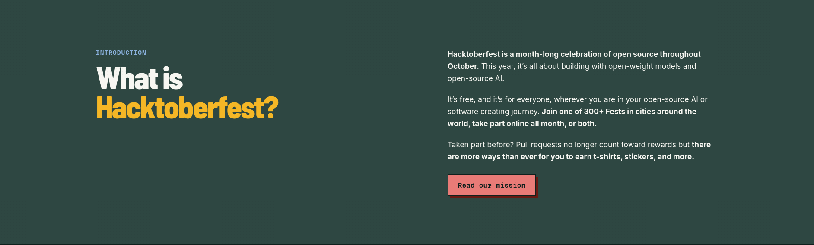

[PHL Code Club](https://phlcode.club) just threw our 2nd annual Hacktoberfest
celebration. However, this year was a little different… The official
Hacktoberfest event has pivoted to open source AI.[^1]

I don't particularly enjoy using AI tooling (See
[Computing For Fun](/blog/computing-for-fun)), so we decided to focus on the parts
we find most fun.

## Making Friends with Open Source

I have met some really interesting people while contributing to open source. They
have taught me quite a bit about software. Things from testing strategies, to
improving communication and documentation, and of course writing better software.

Now better here is a sort of loaded term, but generally these improvements can be
split into one of 3 categories:

### Performance

This is probably the most obvious one. Helping make software perform better is good
not only as sort of badge of honor, but it makes the software easier to run.
This opens up usage on devices that maybe couldn't have handled it before, or
reducing strain on CPUs and batteries.

### Usability

This can be things like fixing bugs, or improving the experience of using the software.
Anytime you are simplify and/or reducing friction for the end user of the
software, that is generally a good thing.

### Maintainability

Now this one might be contentious when it comes to the rise of LLMs for writing
software. I am a firm believer that keeping software maintainable is vital to the
long term success of said software (hot take, I know lol).

## Doing Open Source with Friends

I _love_ working on projects with my friends. Sharing ideas, arguing about solutions,
and ultimately having fun messing with computers is very high on my list of fun
things to do.

One particularly fun project has been the [hacktoberfest classic website](https://codeberg.org/phlcodeclub/hacktober-classic)!
We have been experimenting with translations, which I find is a great way to get
new develops exposure to contributing to open source.

This has been a good exercise for me in writing clear issues and tagging them properly.
"Soft skills" like that can be harder to learn during the day to day of writing
software, especially now as agents are doing more and more of that work.

## Celebrating Hacktoberween

I would be remiss if I didn't mention the super fun celebration [PHL Code Club](https://phlcode.club)
ran at the end of the month. It was part costume party, part show and tell. We
gave out prizes for the people who were able to get some contributions in, including
some sick new stickers that [Inessa](https://thingsforworms.neocities.org) designed.

## Takeaways

Even as the industry changes, I'll still keep doing the parts of software I
find fun. That includes writing my code with my bare hands. I encourage you
to do the same, but also push yourself outside of your comfort zone. Spend a
little more time polishing that commit message, double-check your unit tests,
break apart that massive function. Never stop trying to be better, but make
sure to have fun while you're at it.

- [^1]: I suppose if there is to be any celebration of AI, having it be open source and open weight is one of the better outcomes.
